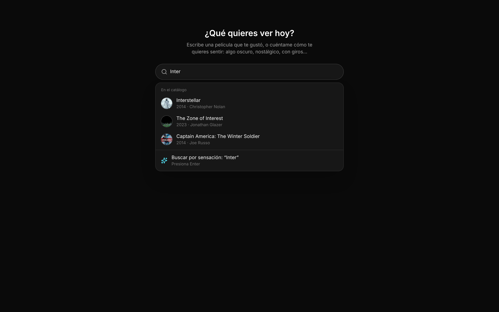
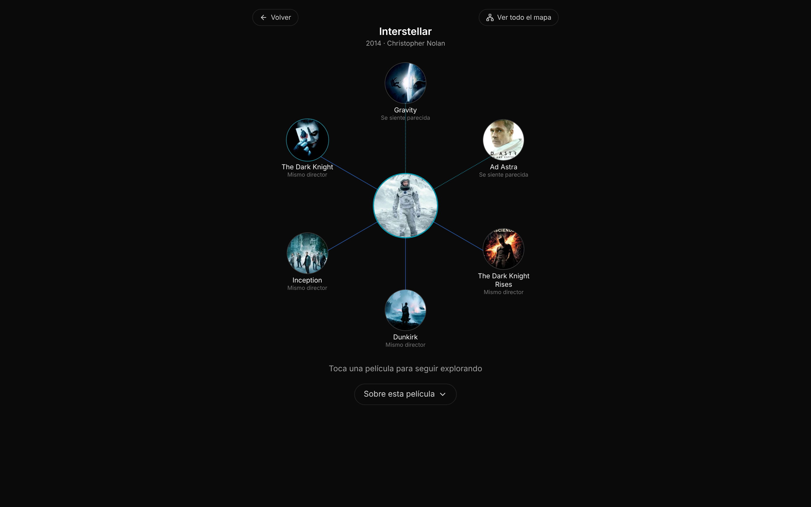
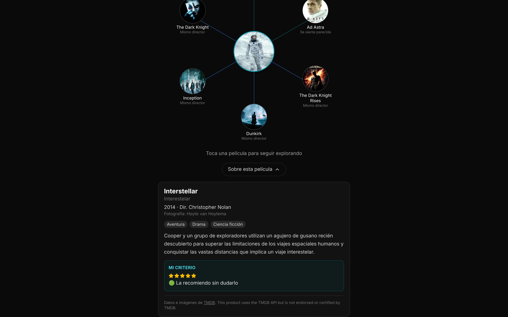
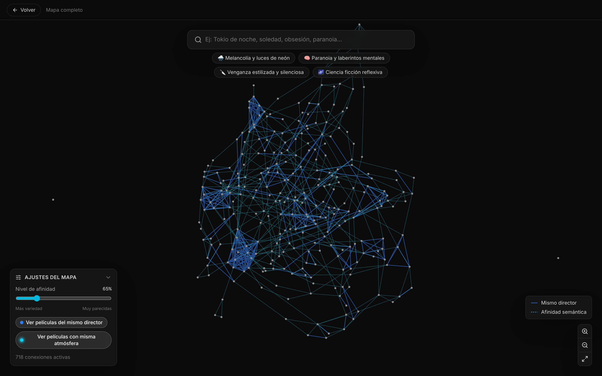

# Watchlist con Criterio — Grafo de Conexiones

Explorador de las películas que he visto, conectadas por lo que realmente comparten: mismo
director y afinidad de tema, tono y atmósfera calculada con embeddings. Escribes una película o
cómo te quieres sentir ("algo oscuro, con giros"), eliges una, y ves sus películas más cercanas,
por qué se conectan y qué opino de ella. El grafo completo queda como vista secundaria.

El catálogo no es una lista genérica: es mi registro personal en Notion (vistas, pendientes,
calificación, recomendación y reseña), sincronizado a la base de datos con un script propio.

**Demo en producción:** https://watchlistconcriterio.vercel.app
**API:** https://watchlist-api-jy0u.onrender.com

> La API corre en el free tier de Render: si nadie la usó en los últimos minutos, la primera
> carga puede tardar 30-60 s mientras el servidor despierta.

## Cómo se usa

**1. Inicio — busca una película o una sensación.** La barra sugiere títulos del catálogo
mientras escribes; si lo que escribes no es un título, Enter lanza una búsqueda semántica por
sensación. También hay temas sugeridos y un botón «Sorpréndeme».



**2. Una película y sus vecinas.** La película elegida va al centro, con hasta 6 películas
conectadas y la razón de cada conexión («Mismo director» o «Se siente parecida»). Tocar
cualquiera la convierte en el nuevo centro.



**3. La ficha.** Tocando el póster del centro o «Sobre esta película» se abre la ficha:
sinopsis, director, fotografía, géneros y el bloque **Mi criterio** (calificación,
recomendación y reseña, cuando las hay).



**4. Mapa completo (opcional).** El grafo entero, con controles de afinidad mínima y tipo de
conexión. Al seleccionar un nodo se abre la misma ficha.



## El problema

Los sistemas de recomendación de streaming agrupan por género/keyword y terminan sugiriendo lo
obvio. Este proyecto responde una pregunta distinta: *¿qué conecta realmente a estas películas?*
— autoría (mismo director) y afinidad de contenido (tema, tono, sensación), no metadata
superficial — y lo hace sobre un catálogo con criterio propio, no sobre un top genérico.

## Arquitectura

```
┌──────────────┐  npm run sync  ┌────────┐   ┌────────────────┐   ┌──────────────────┐   ┌────────────────┐
│ Notion       │───────────────▶│  TMDB  │──▶│ Gemini         │──▶│ Neon (pgvector)  │──▶│ React          │
│ (mi registro)│◀── write-back ─│ (data) │   │ Embeddings 768 │   │ HNSW + k-NN      │   │ EgoView + mapa │
└──────────────┘  TMDB ID/match └────────┘   └────────────────┘   └──────────────────┘   └────────────────┘
```

1. **Fuente — Notion** (`🎬 Películas & Series`): título, año, estado (Visto / Pendiente),
   calificación ⭐1-5, ¿recomendarías? 🟢🟡🔴 y reseña personal.
2. **Sync** (`scripts/sync-notion.js`): lee la base por la API de Notion, resuelve el TMDB ID
   (título + año ±1, o el que se fije a mano en Notion), trae detalle en español + título en
   inglés en una sola llamada a TMDB, genera el embedding solo si la película es nueva y hace
   UPSERT en Neon. Escribe de vuelta en Notion el TMDB ID, el estado del match y el título que
   mostrará la app. Es incremental (salta filas sin cambios) y `--prune` elimina de Neon lo que
   ya no está en Notion.
3. **Almacenamiento** (`schema.sql`, `migrations/`): PostgreSQL en Neon con `pgvector`,
   columna `embedding vector(768)` (`gemini-embedding-001`, truncado de 3072 a 768) e índice
   HNSW (`vector_cosine_ops`).
4. **API** (Express): `GET /api/graph` (nodos + aristas), `POST /api/search/semantic`
   (búsqueda por sensación) y `GET /api/movies/:id` (ficha completa, pedida bajo demanda para
   que el grafo siga liviano). Solo las películas vistas entran al grafo y a la búsqueda.
5. **Frontend** (React + Vite + Zustand + `react-force-graph-2d`): el grafo se trae una vez;
   la vista de una película, los filtros del mapa y las sugerencias se calculan en el cliente.

## Decisiones de diseño

**Notion como fuente del catálogo.** La primera versión usaba 114 títulos de referencia
definidos en el código para que el grafo saliera denso. El nombre del proyecto prometía
"criterio" y ese criterio no era el mío, así que el catálogo pasó a ser mi registro en Notion.
El sync escribe de vuelta el estado del match (OK / Revisar / No encontrada) para corregir en
Notion los casos ambiguos — pegando el TMDB ID correcto — en vez de editar títulos a ciegas, y
respeta el título que se escriba a mano.

**Regla de títulos.** Se muestra el título en inglés, salvo las películas en español, que van
con su título original ("Amores perros", no "Love's a Bitch"; "Parasite", no 기생충). Se
guardan también el título original y el título en español, y la ficha muestra el que difiera.

**Del grafo como pantalla principal a una película con sus vecinas.** Las primeras versiones
abrían directamente en el grafo completo: técnicamente vistoso, pero abrumador para alguien que
solo quiere saber qué ver. El rediseño (CINE-09) pone la búsqueda como puerta de entrada y una
vista centrada en una sola película como pantalla principal. Las vecinas salen del grafo ya
cargado en el cliente (`buildEgoGraph` en `useCineStore.js`): por cada vecina se queda el
vínculo más fuerte, y el cupo de 6 se reparte entre afinidad semántica y mismo director
(cercanía en año), rellenando con sobrantes si un tipo no alcanza.

**k-NN en vez de umbral fijo de similitud.** Un umbral fijo global (≥ 0.78) daba cero aristas:
no se adapta a la densidad local del espacio de embeddings. La solución fue preguntar "¿cuáles
son los 2 vecinos más cercanos de cada película?" (`CROSS JOIN LATERAL ... ORDER BY embedding
<=> embedding LIMIT 2`) y usar 0.65 solo como piso de calidad. Dos ajustes posteriores: la
vecina más cercana siempre entra aunque quede bajo el piso — ninguna película queda aislada — y
los pares se deduplican normalizando con `LEAST/GREATEST` + `DISTINCT ON`, en vez de un filtro
`id_a < id_b` que descartaba pares válidos.

**Cold start del free tier, sin pagar por infraestructura "siempre despierta".** Render duerme
el backend tras inactividad. El frontend usa dos temporizadores: un `AbortController` con
timeout de 90 s da margen para que Render despierte, y un timer de 3 s activa un banner
("Despertando el servidor…") si la respuesta tarda más de lo normal.

**El canvas re-renderiza sin reiniciar la física.** `react-force-graph-2d` reinicia su
simulación si el array de `nodes` cambia de referencia. El store separa `rawGraph.nodes`
(referencia estable) de un hook derivado `useFilteredLinks()` que recalcula solo los `links`:
mover el slider de afinidad o buscar un tema nunca hace que los nodos "salten".

**Matching contra TMDB.** Buscar en español hacía que películas con título original no inglés
casi nunca calzaran exacto, dejando pasar homónimos (un "Parasite" de 1982 en vez del de Bong
Joon-ho). El sync busca en inglés con el año (±1), exige coincidencia exacta de título o título
original para marcar el match como OK, y deja el resto en "Revisar" para decidir a mano.

## Stack — $0 USD / mes

| Capa                 | Servicio                          | Free tier usado |
|----------------------|-----------------------------------|-----------------|
| Frontend             | Vercel                            | Hobby |
| Backend              | Render                            | Free Web Service (duerme tras inactividad) |
| Base de datos        | Neon (PostgreSQL + pgvector)      | Free tier serverless |
| Embeddings           | Google AI Studio — Gemini API     | `gemini-embedding-001`, free tier |
| Metadata de cine     | TMDB API                          | Free tier oficial |
| Fuente del catálogo  | Notion API                        | Integración interna, gratis |

## Métricas del catálogo actual

- **295** películas vistas en el grafo y **95** pendientes guardadas (fuera del grafo).
- **728** aristas: 302 por mismo director y 426 por afinidad semántica (top-2, piso 0.65).
- **0** películas sin conexión.

## Limitaciones conocidas

- **Catálogo cerrado.** Solo se pueden explorar las películas del catálogo; comparar cualquier
  película de TMDB contra él es la siguiente fase.
- **El criterio todavía no pesa en las vecinas.** La ficha muestra calificación y
  recomendación, pero el cálculo de vecinas aún no las usa (🔴 debería excluirse, 🟢 subir).
- **Cold start.** La primera carga tras inactividad tarda 30-60 s (mitigado con el banner, no
  eliminado).
- **Afinidad basada en texto.** Los embeddings se calculan sobre título, géneros y sinopsis de
  TMDB: la "sensación" que capturan es la del texto, no la de la imagen, el ritmo o el sonido.
- **Solo películas.** Las series del registro de Notion no entran todavía.

## Correr en local

```bash
# Backend
git clone https://github.com/DonJuanC/watchlist-con-criterio.git
cd watchlist-con-criterio
cp .env.example .env    # DATABASE_URL, TMDB_API_KEY, GEMINI_API_KEY, NOTION_TOKEN, NOTION_DATA_SOURCE_ID
npm install
npm run test:db         # valida la conexión a Neon
npm run sync -- --dry-run   # muestra qué haría el sync, sin escribir
npm run sync            # sincroniza Notion → Neon (agrega --prune para borrar lo que ya no está)
npm run dev             # API en :4000

# Frontend (otra terminal)
cd frontend
cp .env.example .env    # VITE_API_BASE_URL=http://localhost:4000
npm install
npm run dev             # Vite en :5173
```

Para una base nueva: `schema.sql`. Para una existente: `migrations/` en orden. Los scripts de la
primera versión del catálogo quedan en `scripts/legacy/` como referencia.

Requisitos: [Neon](https://neon.tech) con la extensión `vector`, API key de
[TMDB](https://www.themoviedb.org/settings/api), API key de
[Google AI Studio](https://aistudio.google.com/apikey) y una
[integración interna de Notion](https://www.notion.so/profile/integrations) con acceso a la base.

## Atribución

Datos y pósters de películas provistos por [TMDB](https://www.themoviedb.org/).
This product uses the TMDB API but is not endorsed or certified by TMDB.

<a href="https://www.themoviedb.org/"></a>
