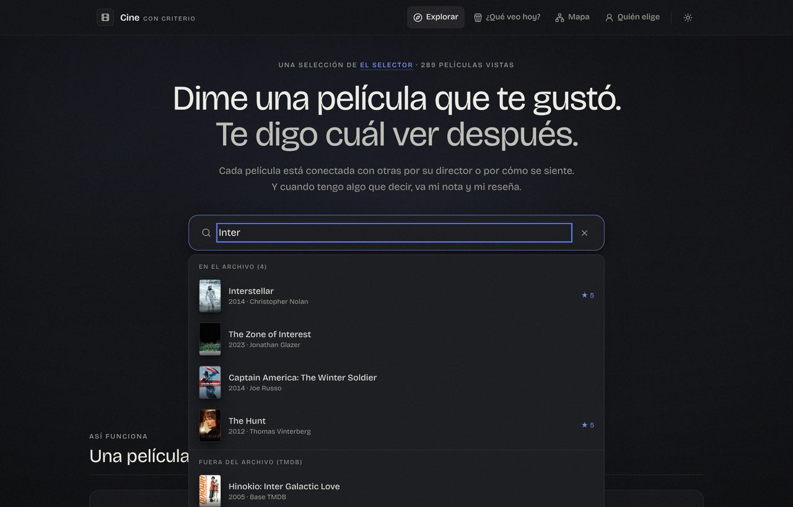
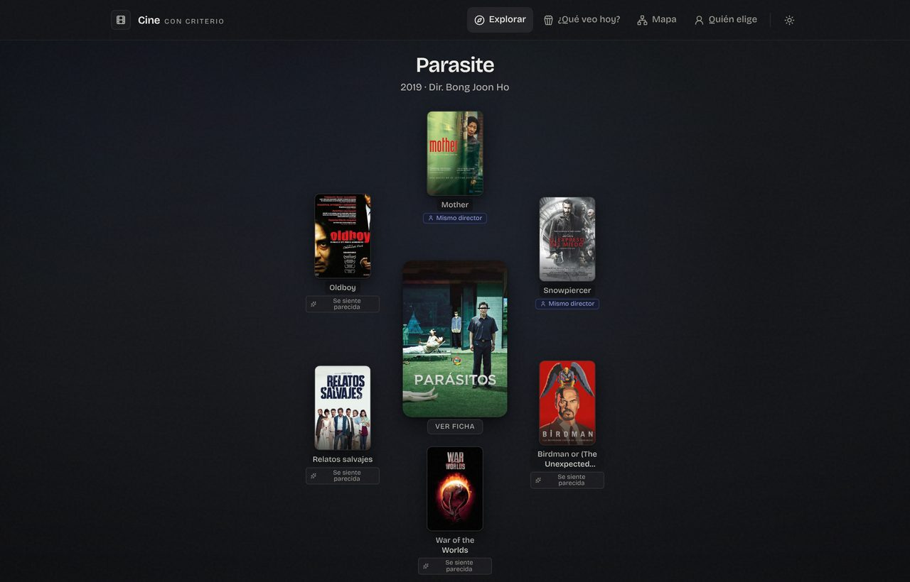
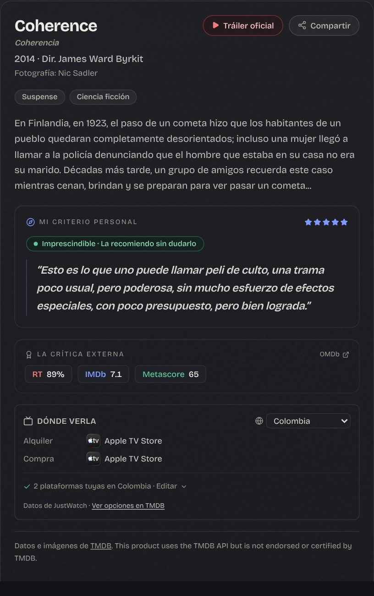
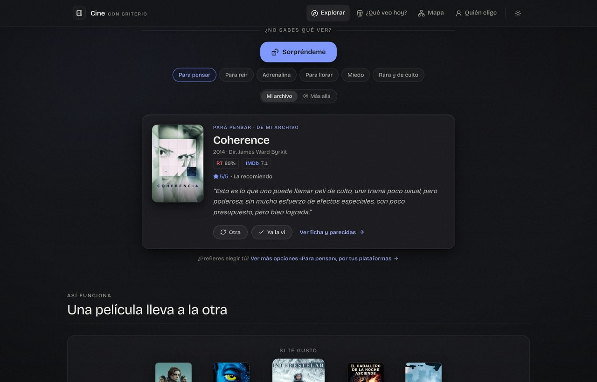
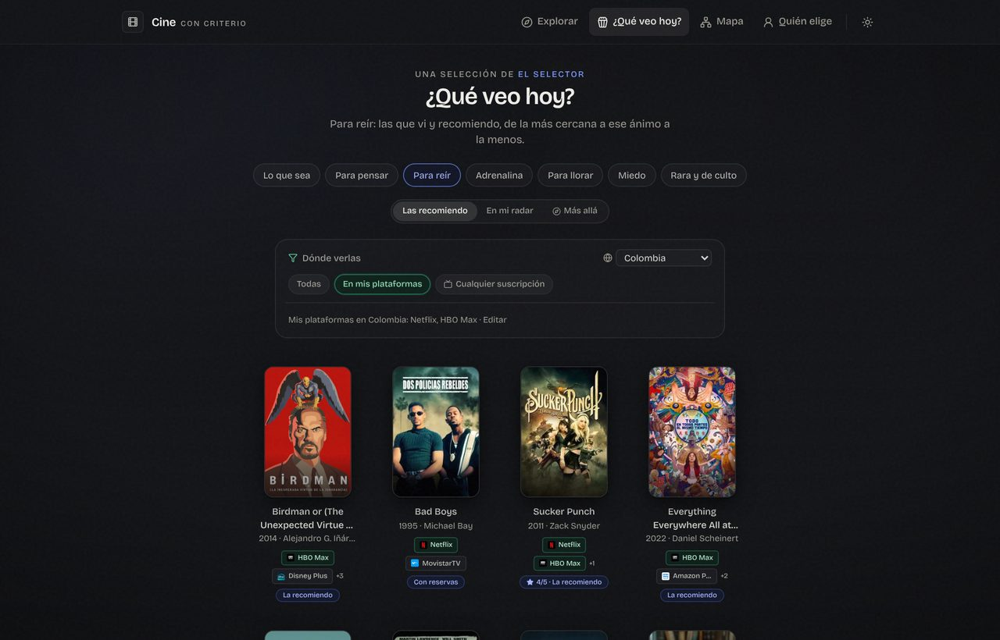
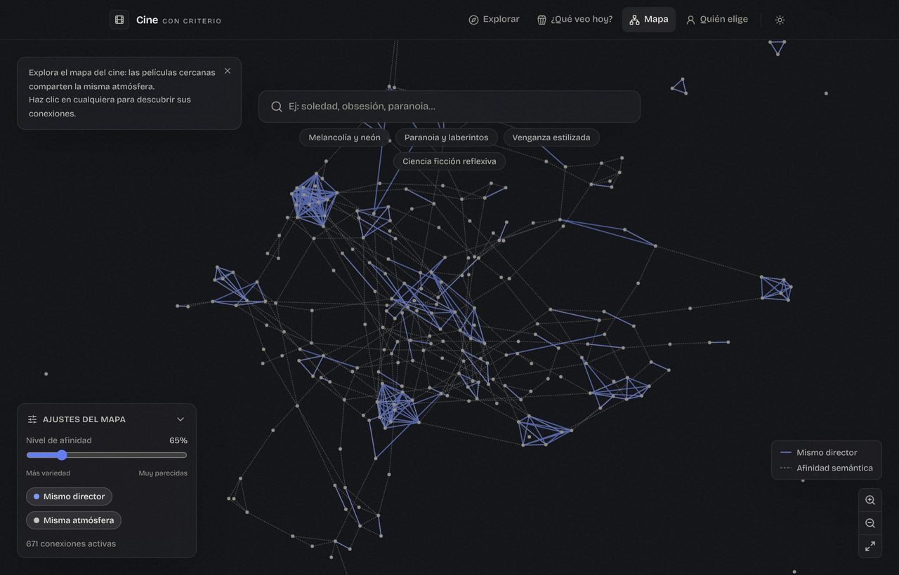

# Watchlist con Criterio — Grafo de Conexiones

Explorador de las películas que he visto, conectadas por lo que realmente comparten: mismo
director y afinidad de tema, tono y atmósfera calculada con embeddings. Escribes una película o
cómo te quieres sentir ("algo oscuro, con giros"), eliges una, y ves sus películas más cercanas,
por qué se conectan y qué opino de ella. Si no tienes una película en mente, eliges un ánimo y
tus plataformas, y te digo qué ver hoy con lo que tienes. El grafo completo queda como vista
secundaria.

El catálogo no es una lista genérica: es mi registro personal en Notion (vistas, pendientes,
calificación, recomendación y reseña), sincronizado a la base de datos con un script propio.

**Demo en producción:** https://pelisconcriterio.vercel.app
**API:** https://watchlist-api-jy0u.onrender.com

> La API corre en el free tier de Render: si nadie la usó en los últimos minutos, la primera
> carga puede tardar 30-60 s mientras el servidor despierta.

## Cómo se usa

**1. Inicio — una película o una sensación.** La barra sugiere títulos mientras escribes, en dos
grupos: los de mi archivo y los de fuera (TMDB). Si lo que escribes no es un título, Enter lanza
una búsqueda semántica por sensación. Debajo: un ejemplo real de cómo se conectan las películas,
las que más recomiendo con su reseña y los directores con más obras en el archivo.



**2. Una película y sus vecinas.** La película elegida va al centro, con hasta 6 películas
conectadas y la razón de cada conexión («Mismo director» o «Se siente parecida»). Las vecinas
respetan mi criterio: las 🔴 no salen, las 🟢 suben y no se repite más de 2 veces un director.
Tocar cualquiera la convierte en el nuevo centro. La URL se sincroniza (`#/movie/:id`), así que
se puede compartir el enlace o usar Atrás/Adelante del navegador. «Ver fuera de mi archivo»
trae sugerencias que no he visto, rotuladas como tales.



**3. La ficha.** Sinopsis, director, fotografía, géneros, tráiler, **Mi criterio** (calificación,
recomendación y reseña), la crítica externa (Rotten Tomatoes, IMDb, Metascore; contexto, no
entra al ranking) y **Dónde verla** en el país del visitante, con sus plataformas primero.



**4. Sin película en mente: Sorpréndeme.** Un botón, o uno de 6 ánimos (para pensar, para reír,
adrenalina, para llorar, miedo, rara y de culto), y sale UNA película con mi nota y mi reseña.
«Otra» no repite en la visita; «Ya la vi» la saca para siempre en ese navegador. «Más allá»
sortea fuera de mi archivo. Debajo, «Ver más opciones» abre la lista con el mismo ánimo.



**5. ¿Qué veo hoy?** La versión en lista de Sorpréndeme, pensada para decidir con lo que se tiene.
El país se detecta solo y el visitante marca sus plataformas una vez (desde el inicio, la ficha
o esta vista). Tres fuentes:

- *Las recomiendo*: mis 🟢 y 🟡, con mi nota. Sin ánimo, el orden cambia cada día.
- *En mi radar*: mis pendientes, con la razón («Porque me gustó 28 Days Later»).
- *Más allá*: sugerencias de TMDB a partir de las mías, re-rankeadas por similitud; no las he visto.

El filtro (*En mis plataformas* / *Cualquier suscripción*) corre en el servidor sobre toda la
lista, así que «Ver otras opciones» sigue filtrado. La URL guarda ánimo y fuente
(`#/que-veo-hoy?animo=reir&fuente=radar`).



**6. Mapa completo.** El grafo entero, cargado de forma diferida, con controles de afinidad
mínima y tipo de conexión. Al seleccionar un nodo se abre la misma ficha.



**7. Criterio Studio (`#/admin`).** Panel de curaduría protegido por contraseña (`ADMIN_PASSWORD`):
buscar cualquier título en TMDB, asignarle estado (*Visto* o *Pendiente*), calificación,
veredicto 🟢🟡🔴 y reseña. Al guardar se actualiza Neon, se regenera el embedding con Gemini y se
sincroniza con Notion en ambas direcciones.

## El problema

Los sistemas de recomendación de streaming agrupan por género/keyword y terminan sugiriendo lo
obvio. Este proyecto responde una pregunta distinta: *¿qué conecta realmente a estas películas?*
— autoría (mismo director) y afinidad de contenido (tema, tono, sensación), no metadata
superficial — y lo hace sobre un catálogo con criterio propio, no sobre un top genérico.

## Arquitectura

```
┌──────────────┐  npm run sync  ┌────────┐   ┌────────────────┐   ┌──────────────────┐   ┌────────────────┐
│ Notion       │───────────────▶│  TMDB  │──▶│ Gemini         │──▶│ Neon (pgvector)  │──▶│ React          │
│ (mi registro)│◀── write-back ─│ (data) │   │ Embeddings 768 │   │ HNSW + k-NN      │   │ EgoView + mapa │
└──────────────┘  TMDB ID/match └───┬────┘   └────────────────┘   │ + disponibilidad │   │ + ¿Qué veo hoy?│
                                    │  npm run availability       │   por país       │   └────────────────┘
                                    └────────────────────────────▶└──────────────────┘
                 OMDb (npm run ratings) ──▶ notas de la crítica en Neon
```

1. **Fuente — Notion** (`🎬 Películas & Series`): título, año, estado (Visto / Pendiente),
   calificación ⭐1-5, ¿recomendarías? 🟢🟡🔴 y reseña personal.
2. **Sync** (`scripts/sync-notion.js`): lee la base por la API de Notion, resuelve el TMDB ID
   (título + año ±1, o el que se fije a mano en Notion), trae detalle en español + título en
   inglés en una sola llamada a TMDB, genera el embedding semántico enriquecido (título, director,
   géneros, sinopsis y la reseña personal de Notion) si la película es nueva o si la reseña fue
   editada, y hace UPSERT en Neon. Escribe de vuelta en Notion el TMDB ID, el estado del match y el título que
   mostrará la app. Es incremental (salta filas sin cambios) y `--prune` elimina de Neon lo que
   ya no está en Notion. Soporta `--reembed` para regenerar con el formato enriquecido.
3. **Almacenamiento** (`schema.sql`, `migrations/`): PostgreSQL en Neon con `pgvector`,
   columna `embedding vector(768)` (`gemini-embedding-001`, truncado de 3072 a 768) e índice
   HNSW (`vector_cosine_ops`).
4. **Disponibilidad** (`scripts/fetch-availability.js`, `migrations/005`): dónde ver cada
   película del catálogo, por país (JustWatch vía TMDB), en `watch_availability`. Se refresca
   cuando tiene más de 7 días: en el workflow de sync y al abrir una ficha vencida.
5. **API** (Express). Las rutas principales:
   - `GET /api/graph` (nodos + aristas) y `GET /api/movies/:id` (ficha, bajo demanda para que
     el grafo siga liviano). Solo las vistas entran al grafo.
   - `GET /api/movies/:id/neighbors`: las vecinas con mi criterio aplicado.
   - `POST /api/search/semantic`, `GET /api/movies/search`, `POST /api/recommend`: búsqueda por
     sensación y búsqueda abierta en TMDB.
   - `GET /api/recommend/surprise` (Sorpréndeme) y `GET /api/recommend/next` («¿Qué veo hoy?»:
     `source`, `mood`, `country`, `avail`, `providers`).
   - `POST /api/beyond`: fuera de mi archivo.
   - `GET /api/watch/platforms?country=` (plataformas populares del país) y
     `GET /api/watch/:tmdbId?country=` (dónde ver una película).
6. **Frontend** (React + Vite + Zustand + `react-force-graph-2d`): el grafo se trae una vez;
   la vista de una película, los filtros del mapa y las sugerencias se calculan en el cliente.
   País y plataformas del visitante viven en un estado compartido (`useCountry`) guardado en su
   navegador. Una función de Vercel (`frontend/api/geo.js`) da el país por IP.

## Decisiones de diseño

**Notion como fuente del catálogo.** La primera versión usaba 114 títulos de referencia
definidos en el código para que el grafo saliera denso. El nombre del proyecto prometía
"criterio" y ese criterio no era el mío, así que el catálogo pasó a ser mi registro en Notion.
El sync escribe de vuelta el estado del match (OK / Revisar / No encontrada) para corregir en
Notion los casos ambiguos — pegando el TMDB ID correcto — en vez de editar títulos a ciegas, y
respeta el título que se escriba a mano.

**Regla de títulos.** Se muestra el título en inglés, salvo las películas en español, que van
con su título original ("Amores perros", no "Love's a Bitch"; "Parasite", no 기생충). Se
guardan también el título original y el título en español, y la ficha muestra el que difiera.

**Del grafo como pantalla principal a una película con sus vecinas.** Las primeras versiones
abrían directamente en el grafo completo: técnicamente vistoso, pero abrumador para alguien que
solo quiere saber qué ver. El rediseño (CINE-09) pone la búsqueda como puerta de entrada y una
vista centrada en una sola película como pantalla principal. Al principio las vecinas salían
del grafo cargado en el cliente; para que respetaran mi criterio (sin 🔴, 🟢 primero, máximo 2
por director) pasaron al servidor (`/api/movies/:id/neighbors`, `src/services/neighborRanking.js`),
que además pagina para «Otras opciones» y excluye lo que el visitante marcó como visto.

**k-NN en vez de umbral fijo de similitud.** Un umbral fijo global (≥ 0.78) daba cero aristas:
no se adapta a la densidad local del espacio de embeddings. La solución fue preguntar "¿cuáles
son los 2 vecinos más cercanos de cada película?" (`CROSS JOIN LATERAL ... ORDER BY embedding
<=> embedding LIMIT 2`) y usar 0.65 solo como piso de calidad. Dos ajustes posteriores: la
vecina más cercana siempre entra aunque quede bajo el piso — ninguna película queda aislada — y
los pares se deduplican normalizando con `LEAST/GREATEST` + `DISTINCT ON`, en vez de un filtro
`id_a < id_b` que descartaba pares válidos.

**«¿Qué veo hoy?» y Sorpréndeme: una sola función en dos tamaños.** Al abrir el sitio al
público aparecieron dos formas de resolver lo mismo («no sé qué ver») con criterios distintos:
Sorpréndeme sacaba de mi archivo con 6 ánimos y «¿Qué veo hoy?» solo de mis pendientes con
texto libre. Un visitante que probara las dos no tenía cómo saber por qué le recomendaban cosas
distintas, y además las pendientes son mi lista, no la suya. Ahora comparten ánimos
(`src/services/moods.js`) y fuentes. La diferencia es de profundidad: una película contra una
lista filtrable por plataforma. Los ánimos son presets y no texto libre para que cada uno
cueste un solo embedding de Gemini por vida del proceso.

**Disponibilidad en la base, no en el navegador.** La primera versión del filtro por plataforma
pedía dónde ver cada una de las 12 películas cargadas y filtraba ese lote: con Netflix en
Colombia quedaban 0-2 resultados y «Otras opciones» paginaba sobre vacío. Guardar la
disponibilidad de las ~390 películas del catálogo (unas 31.000 filas película×país, 21 MB) en
Neon permite filtrar en SQL antes de paginar. Las películas de fuera del catálogo van solo a
caché en memoria para que la tabla no crezca con cada búsqueda.

**Plataformas con clave normalizada.** TMDB lista la misma plataforma de varias formas («HBO Max»
y «HBO Max Amazon Channel», «Paramount Plus» y «Paramount+», «Netflix Standard with Ads»). Una
clave normalizada (`src/services/platforms.js`) las unifica, deja fuera las tiendas de alquiler
y es lo que se guarda como «mis plataformas». Las plataformas del selector salen de la prioridad
de JustWatch por país: en Colombia aparecen Claro video y VIX; en España, Movistar Plus+ y Filmin.

**País en capas.** El idioma del navegador solo no alcanza: alguien en Bogotá con el navegador
en inglés caía en Estados Unidos. El orden es la elección guardada, el país por IP (header de
Vercel), la zona horaria y, al final, el idioma.

**Cold start del free tier, sin pagar por infraestructura "siempre despierta".** Render duerme
el backend tras inactividad. El frontend usa dos temporizadores: un `AbortController` con
timeout de 90 s da margen para que Render despierte, y un timer de 3 s activa un banner
("Despertando el servidor…") si la respuesta tarda más de lo normal.

**El canvas re-renderiza sin reiniciar la física.** `react-force-graph-2d` reinicia su
simulación si el array de `nodes` cambia de referencia. El store separa `rawGraph.nodes`
(referencia estable) de un hook derivado `useFilteredLinks()` que recalcula solo los `links`:
mover el slider de afinidad o buscar un tema nunca hace que los nodos "salten".

**Matching contra TMDB.** Buscar en español hacía que películas con título original no inglés
casi nunca calzaran exacto, dejando pasar homónimos (un "Parasite" de 1982 en vez del de Bong
Joon-ho). El sync busca en inglés con el año (±1), exige coincidencia exacta de título o título
original para marcar el match como OK, y deja el resto en "Revisar" para decidir a mano.

## Stack — $0 USD / mes

| Capa                 | Servicio                          | Free tier usado |
|----------------------|-----------------------------------|-----------------|
| Frontend             | Vercel                            | Hobby |
| Backend              | Render                            | Free Web Service (duerme tras inactividad) |
| Base de datos        | Neon (PostgreSQL + pgvector)      | Free tier serverless |
| Embeddings           | Google AI Studio — Gemini API     | `gemini-embedding-001`, free tier |
| Metadata de cine     | TMDB API                          | Free tier oficial |
| Fuente del catálogo  | Notion API                        | Integración interna, gratis |

## Métricas del catálogo actual

- **289** películas vistas en el grafo y **102** pendientes (fuera del grafo, en «En mi radar»).
- **88** calificadas con veredicto: 50 🟢, 34 🟡, 4 🔴.
- **688** aristas: 297 por mismo director y 391 por afinidad semántica (top-2, piso 0.65).
- **0** películas sin conexión.
- Disponibilidad guardada para las **391** películas del catálogo en todos los países que
  reporta JustWatch.

## Limitaciones conocidas y Estado

- **Criterio en las vecinas (Implementado):** El ranking de afinidad prioriza las películas recomendadas e ignora las calificadas negativamente.
- **Cold start mitigado:** Mitigado activamente mediante un cron job periódico en GitHub Actions (`.github/workflows/warmup.yml`) que mantiene despierto el servidor en horarios activos, sumado a una caché en memoria de 1 hora en la API.
- **Sincronización automática de Notion:** GitHub Actions (`.github/workflows/sync-notion.yml`) corre automáticamente 2 veces al día (00:00 y 12:00 hora Colombia / UTC-5) para sincronizar nuevas películas y reseñas editadas directamente a Neon y regenerar embeddings. Requiere configurar en los secretos del repositorio de GitHub (`Settings > Secrets and variables > Actions`): `DATABASE_URL`, `NOTION_TOKEN`, `NOTION_DATA_SOURCE_ID`, `TMDB_API_KEY` y `GEMINI_API_KEY`.
  El mismo workflow refresca la disponibilidad vencida (`npm run availability`).
- **Embeddings enriquecidos con criterio (Implementado):** Los vectores semánticos de 768 dimensiones incorporan el director y la reseña personal de Notion además de la metadata de TMDB.
- **Disponibilidad según JustWatch vía TMDB:** si una plataforma no reporta un título, no
  aparece. TMDB a veces devuelve vacía la lista de plataformas de un país (pasa con México);
  en ese caso se usa la prioridad por país del catálogo global.
- **«Ya la vi» y «mis plataformas» viven en el navegador del visitante** (`localStorage`): no
  hay cuentas, así que no viajan entre dispositivos.
- **Solo películas:** Las series del registro de Notion no entran todavía.

## Correr en local

```bash
# 1. Clonar el repositorio
git clone https://github.com/DonJuanC/watchlist-con-criterio.git
cd watchlist-con-criterio

# 2. Configurar variables de entorno (.env)
cp .env.example .env    # DATABASE_URL, TMDB_API_KEY, GEMINI_API_KEY, NOTION_TOKEN, NOTION_DATA_SOURCE_ID, OMDB_API_KEY
cp frontend/.env.example frontend/.env  # VITE_API_BASE_URL=http://localhost:4000

# 3. Instalar dependencias (raíz y frontend)
npm install
npm --prefix frontend install

# 4. Validar conexión y sincronizar catálogo si es necesario
npm run test:db         # valida la conexión a Neon
npm run sync            # sincroniza Notion → Neon (opcional: --dry-run)
npm run ratings         # notas de la crítica desde OMDb (incremental)
npm run availability    # dónde ver cada película, por país (incremental, ~30 s el catálogo)

# 5. Iniciar Backend y Frontend concurrentemente con un solo comando:
npm run dev             # Backend en :4000 y Vite Frontend en :5173
```

Para correrlos por separado si se prefiere:
* `npm run dev:backend` (Express en `:4000`)
* `npm run dev:frontend` (Vite en `:5173`)

Para una base nueva: `schema.sql`. Para una existente: `migrations/` en orden. Los scripts de la
primera versión del catálogo quedan en `scripts/legacy/` como referencia.

Requisitos: [Neon](https://neon.tech) con la extensión `vector`, API key de
[TMDB](https://www.themoviedb.org/settings/api), API key de
[OMDb](https://www.omdbapi.com/apikey.aspx), API key de
[Google AI Studio](https://aistudio.google.com/apikey) y una
[integración interna de Notion](https://www.notion.so/profile/integrations) con acceso a la base.

## Atribución

Datos y pósters de películas provistos por [TMDB](https://www.themoviedb.org/). Disponibilidad en
plataformas: [JustWatch](https://www.justwatch.com/) vía TMDB. Notas de la crítica: [OMDb](https://www.omdbapi.com/).
This product uses the TMDB API but is not endorsed or certified by TMDB.

<a href="https://www.themoviedb.org/"></a>
